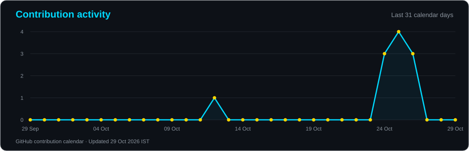
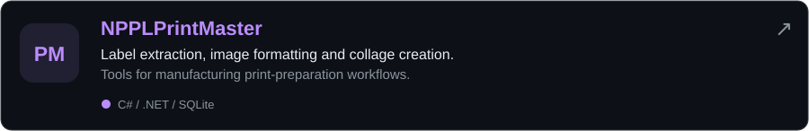
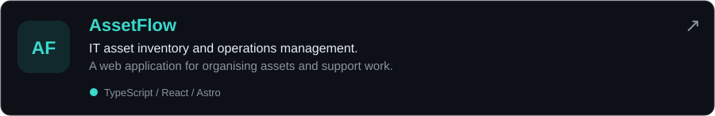

<div align="center">

[](https://github.com/yateshr)


**IT Officer at Nirmal Poly Plast Private Limited**  
Sarigam, Gujarat, India

</div>

---

<div align="center">

[](https://github.com/yateshr) [](https://github.com/yateshr?tab=followers) [](https://github.com/yateshr?tab=repositories)

</div>

---

## `whoami`

```python
class YateshRohit:
    name        = "Yatesh Rohit"
    designation = "IT Officer"
    company     = "Nirmal Poly Plast Private Limited"
    location    = "Sarigam, Gujarat, India"
    status      = "Building tools for everyday work"

    projects    = ["TypeMaster", "NPPLPrintMaster", "AssetFlow"]
    interests   = ["Automation", "Desktop Apps", "IT Tools", "Open Source"]
    focus       = "Useful software, clear reports and simpler workflows"

    def __repr__(self):
        return "Turning everyday problems into practical software."
```

---

## Tech Arsenal

<div align="center">

### Languages

      

### Frameworks & Libraries

    

### Development & Automation

   

### Data & Tools

   

</div>

The technologies above are used across my published projects and their build tools.

---

## GitHub Stats

<div align="center">

   

<br />

[](https://github.com/yateshr?tab=overview)

</div>

---

## Contribution Graph

<div align="center">

[](https://github.com/yateshr?tab=overview)

</div>

---

## Featured Projects

<div align="center">

[](https://github.com/yateshr/TypeMaster)

[Download TypeMaster](https://github.com/yateshr/TypeMaster/releases) · [Screenshots and reports](https://github.com/yateshr/TypeMaster/blob/main/docs/SCREENSHOTS.md)

[](https://github.com/yateshr/NPPLPrintMaster)

[Explore NPPLPrintMaster](https://github.com/yateshr/NPPLPrintMaster) · [Releases](https://github.com/yateshr/NPPLPrintMaster/releases)

[](https://github.com/yateshr/AssetFlow)

[Explore AssetFlow](https://github.com/yateshr/AssetFlow)

</div>

---

## Random Dev Quote

<div align="center">


</div>

---

## Let's Connect

<div align="center">

[](https://github.com/yateshr)

</div>

---

<div align="center">


**Practical tools. Thoughtful automation.**

</div>
